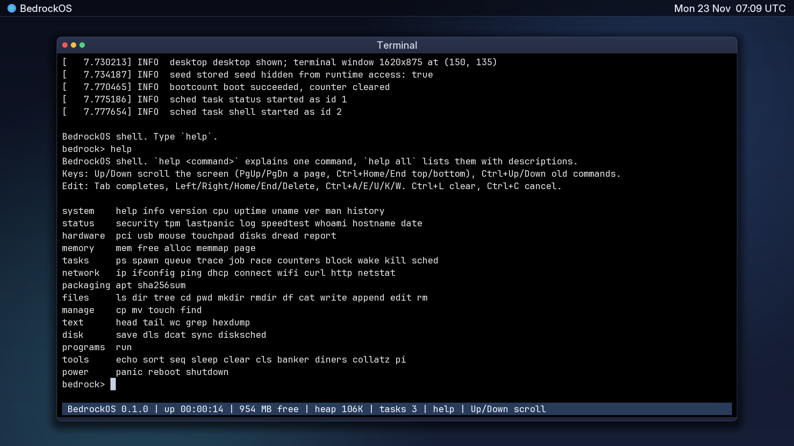
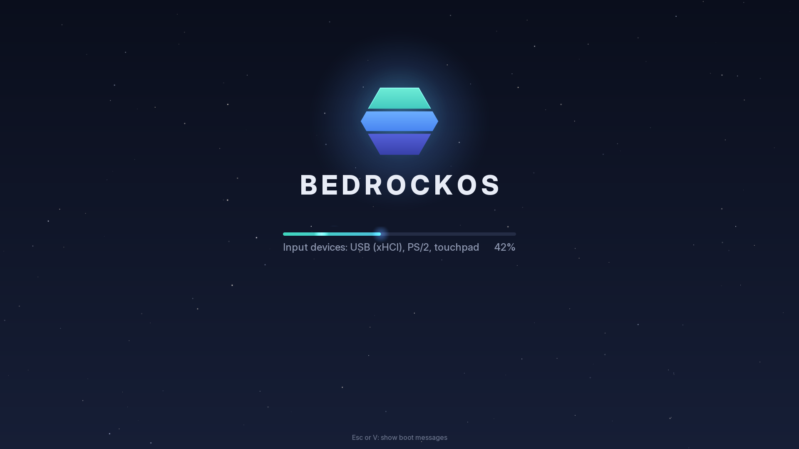

# BedrockOS

A small x86_64 UEFI operating system in Rust (`no_std`, no third-party crates in the kernel), built on
the Aeon 0.11.0 kernel. The goal: an animated boot, a graphical desktop with Notes, Tasks, a Browser, a
Terminal, Wi-Fi and Settings apps, running by itself in VirtualBox and from a USB stick on real UEFI PCs.

**Current state: milestone 3 of 10, first part.** It boots in VirtualBox with an animated boot screen and
boot menu, then fades into a desktop with a top panel and a Terminal window running the shell. There is no
window manager, mouse support on the desktop, or other apps yet. See
[`docs/STATUS.md`](docs/STATUS.md) for exactly what is done and tested, and [`docs/PLAN.md`](docs/PLAN.md)
for the design.

## Screenshots (VirtualBox, captured from real boots)

Desktop with the shell in the Terminal window (1920x1080, `help` typed):



| Boot menu with countdown (1920x1080) | Boot progress driven by real stages (1920x1080) |
|---|---|
|  |  |

Pressing Esc or V during boot switches to the scrolling log:


## Quick start

```sh
cargo xtask build          # out/bedrockos.efi, out/usb/, out/bedrockos.img, out/bedrockos.vdi
scripts\vbox.bat           # Windows: create + start the VirtualBox VM
sh scripts/vbox.sh         # Linux / macOS
python tests/vbox_boot.py  # automated VirtualBox boot test
```

Details: [`docs/BUILD.md`](docs/BUILD.md) · USB stick: [`docs/USB.md`](docs/USB.md)

## Credits and licences

Kernel, drivers and shell derive from Aeon 0.11.0 (the author's earlier OS). Fonts: Inter and JetBrains Mono,
SIL Open Font License 1.1 (`docs/licenses/`).
