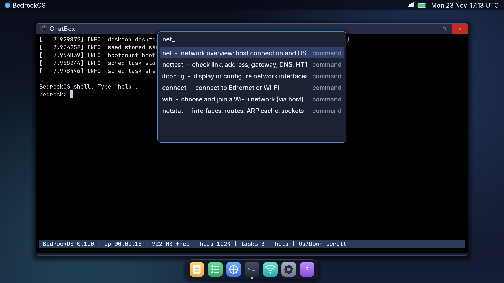
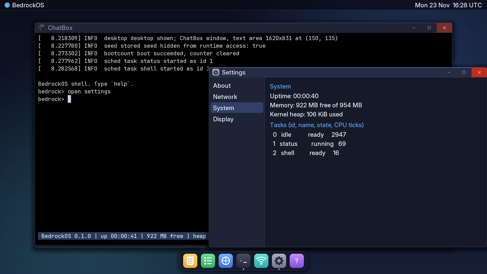
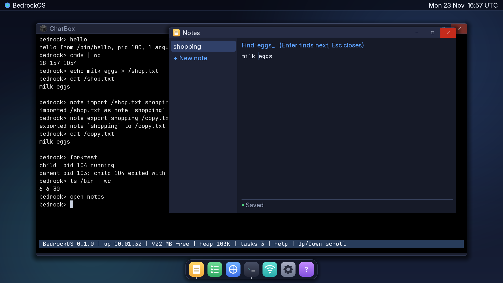
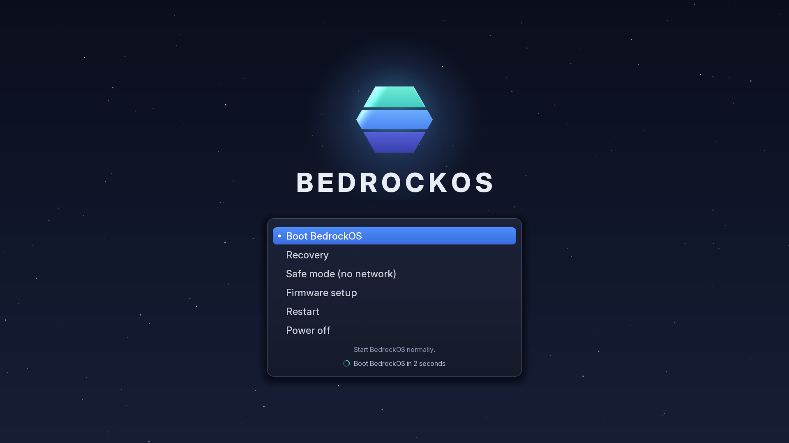
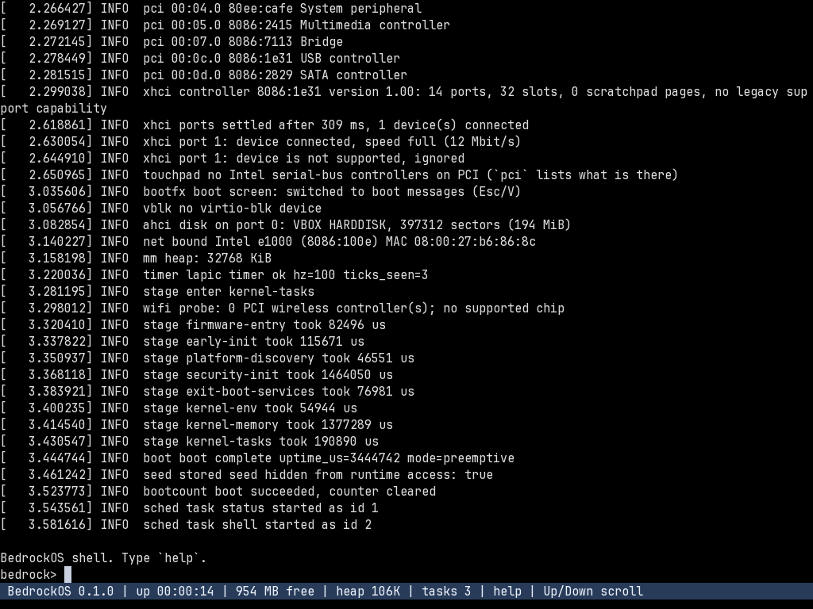

# BedrockOS

A small x86_64 UEFI operating system in Rust (`no_std`, no third-party crates in the kernel), built on
the Aeon 0.11.0 kernel. The goal: an animated boot, a graphical desktop with Notes, Tasks, a Browser, a
Terminal, Wi-Fi and Settings apps, running by itself in VirtualBox and from a USB stick on real UEFI PCs.

**Current state: release 0.1.0: milestones 1–7 and 10 done; 8 (own Wi-Fi drivers) and 9 (browser) are
not.** It boots in VirtualBox with an animated boot screen and boot menu, then fades into a desktop with:

- a top bar with the clock (time zone, `tz`), the network and the battery percentage; point at them for details;
- windows you can move, focus, minimise, close and maximise (Ctrl+M), Ctrl+T switches between them;
- **ChatBox**, the shell: more than 100 commands (`help`, `cmds`), pipes, redirects and /bin programs;
- **Notes** (undo/redo, find, rename, line copy/paste, `.txt` import/export), **Tasks**, **Help**, and
  **Settings** (about, network, live system and task view, display);
- **Files**, **Network**, **Calculator**, **Clock** (world clocks, stopwatch), **Snake** and the **Crafting Table**
  web browser, all in the dock;
- a sign-in screen before the boot menu (user `BedrockOS`), Minecraft-style "Achievement get!" toasts
  (`achievements` lists them) and a wallpaper that follows day and night;
- Wi-Fi through the laptop (`wifi scan`, `wifi connect`) and https pages for the browser: run
  `python tools/bedrock-host.py` on the laptop while the VM runs;
- a **command palette** (Ctrl+Space) that opens apps or runs commands;
- networking through the laptop's connection (`nettest` checks link, address, gateway, DNS and HTTP);
- files, notes and tasks saved to the VM disk (or a USB stick), so they survive a reboot.

See [`docs/STATUS.md`](docs/STATUS.md) for exactly what is done and how it was tested, and
[`docs/PLAN.md`](docs/PLAN.md) for the design.

## Screenshots (VirtualBox, captured from real boots)

Desktop with ChatBox (1920x1080, `nettest` run from the command palette):


| Command palette (Ctrl+Space) | Settings: live system and task view |
|---|---|
|  |  |

Notes with find (Ctrl+F) next to ChatBox:



## Using it

| Keys | What they do |
|---|---|
| Ctrl+Space | command palette: type, Up/Down, Enter; Esc closes |
| Ctrl+T | next window |
| ChatBox | Tab completes, Ctrl+Up/Down history, Up/Down/PgUp/PgDn scroll, Ctrl+L clear, Ctrl+C cancel |
| Notes | Ctrl+N new, Ctrl+D delete, Ctrl+R rename, Ctrl+F find, Ctrl+Z/Y undo/redo, Ctrl+C/X/V line, Ctrl+Up/Down switch note |
| Tasks | type + Enter adds, Down selects, Space done, Delete removes |

Useful commands: `help`, `cmds`, `keys`, `open <app>`, `nettest`, `neofetch`, `calc (2+3)*4`, `task add <text>`,
`note list`, `help | grep net`.

| Boot menu with countdown (1920x1080) | Boot progress driven by real stages (1920x1080) |
|---|---|
|  |  |

Pressing Esc or V during boot switches to the scrolling log:



## Quick start

```sh
cargo xtask build          # out/bedrockos.efi, out/usb/, out/bedrockos.img, out/bedrockos.vdi
scripts\vbox.bat           # Windows: create + start the VirtualBox VM
sh scripts/vbox.sh         # Linux / macOS
python tests/vbox_boot.py  # automated VirtualBox boot test
```

Details: [`docs/BUILD.md`](docs/BUILD.md) · USB stick: [`docs/USB.md`](docs/USB.md)

## Credits and licences

Kernel, drivers and shell derive from Aeon 0.11.0 (the author's earlier OS). Fonts: Inter and JetBrains Mono,
SIL Open Font License 1.1 (`docs/licenses/`).
